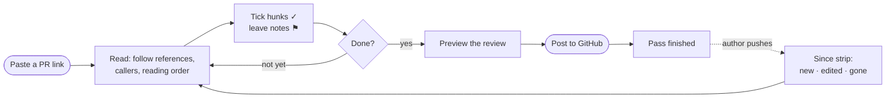
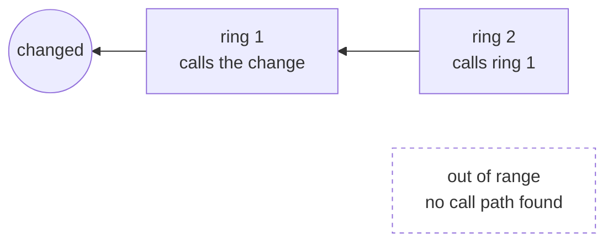
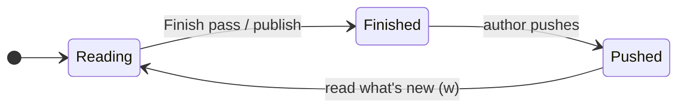
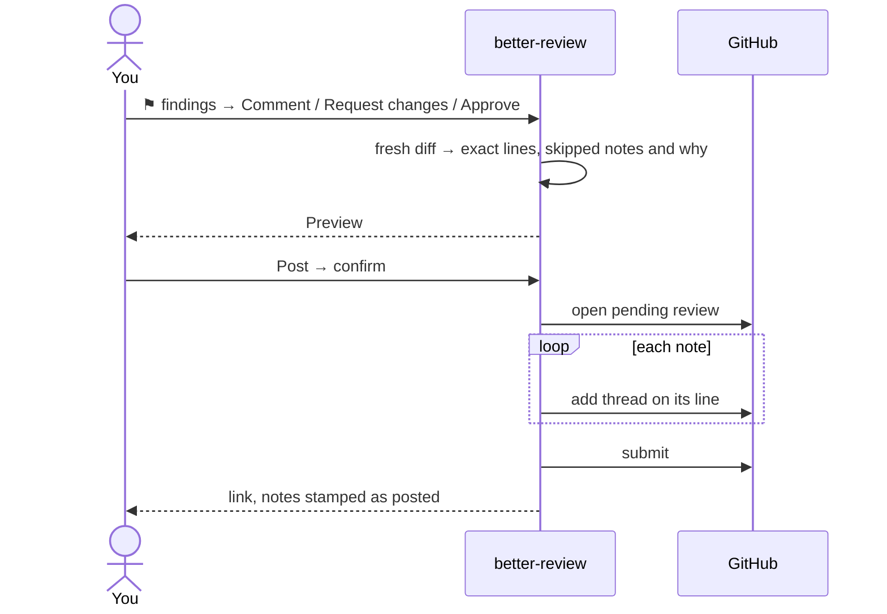
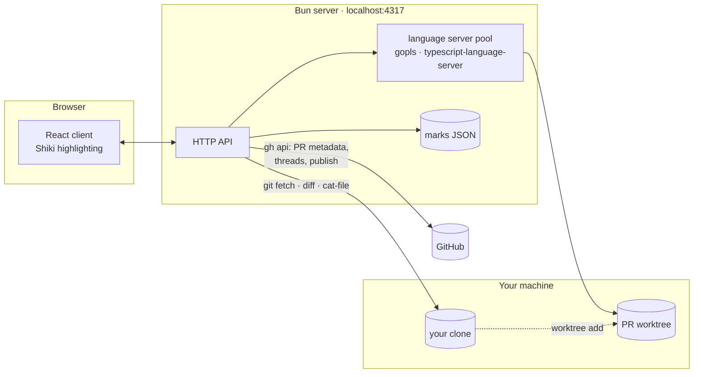

<div align="center">

# better-review

**Read a GitHub pull request properly.**

Follow the code, not the scroll bar. Know how far each file sits from the change.
Tick off what you have read, see what changed since you last looked, and publish one
clean review to GitHub.

Runs locally, against your own clone. One GitHub call for the PR's metadata; everything
else is `git`.

[Quick start](#quick-start) · [Features](#features) · [Keys](#keyboard-shortcuts) ·
[Configuration](#configuration) · [How it works](#how-it-works) ·
[Troubleshooting](#troubleshooting) · [Development](#development)

</div>

---

## Quick start

```bash
git clone git@github.com:mmNalaka/better-review.git && cd better-review
bun install && bun run build
bun start owner/repo#123          # opens http://localhost:4317
```

You need [Bun](https://bun.sh) ≥ 1.2, `git`, the [GitHub CLI](https://cli.github.com)
logged in, and a local clone of the repo you are reviewing under `~/code` (or wherever
[`BR_CLONE_ROOTS`](#configuration) points). Check everything at once:

```console
$ bun run doctor
✓ git            git version 2.50.1
✓ gh             gh version 2.87.3
✓ gh auth        logged in
✓ built client   /Users/you/code/better-review/web/dist
✓ clone roots    /Users/you/code
  marks          /Users/you/Library/Application Support/better-review/marks
  optional       · gopls (Go)   · typescript-language-server (TypeScript)
```

The optional entries are language servers. Without them everything works except the
features marked 🧠 below, which report *not applicable* for languages they cannot read.

<details>
<summary><b>Use it as a command from anywhere</b></summary>

```bash
bun link                          # once, from the repo
better-review owner/repo#123      # from any directory
```

```
better-review [pr] [options]

  pr                 owner/repo#123, or a pull request URL, opened on start
  --port <n>         port to listen on (default 4317)
  --no-open          do not open a browser
  --doctor           check the things this needs, then exit
  --help, --version
```

Publishing to a registry is not set up: `package.json` is `"private": true` and there
is no licence yet.

</details>

---

## Contents

- [The screen](#the-screen)
- [A review, start to finish](#a-review-start-to-finish)
- [Features](#features)
  - [Navigate by reference](#navigate-by-reference) · [Rings](#rings-distance-from-the-change) · [Callers and reading order](#callers-and-reading-order) · [Callers left behind](#callers-left-behind)
  - [Marking](#marking) · [Re-review after a push](#re-review-after-a-push) · [Existing threads](#existing-threads)
  - [Commenting](#commenting) · [Publishing](#publishing) · [History and compare](#history-and-compare) · [Description and conversation](#description-and-conversation)
- [Keyboard shortcuts](#keyboard-shortcuts)
- [Configuration](#configuration)
- [How it works](#how-it-works)
- [Troubleshooting](#troubleshooting)
- [Development](#development)

---

## The screen

```
┌────────────────────────────────────────────────────────────────────────────────────┐
│ [ owner/repo#123        ]  Title of the PR   32 changed · 7 commits · 4 comments   │
│                            2 open threads · callers left behind        ?  ⛶        │
├────────────────────────────────────────────────────────────────────────────────────┤
│ View: Diff + file │ Diff only │ Whole file       History   Finish pass   ⚑ findings│
├────────────────────────────────────────────────────────────────────────────────────┤
│ 3 new commits · force-pushed · 5 new · 2 edited · 1 gone          What's new       │  ← after a push
├────────────────────────────────────────────────────────────────────────────────────┤
│ The changes › api.ts:40 › store.ts:112 › db.ts:9                                   │  ← the trail
├──────────────────┬────────────────────────────┬────────────────────────────────────┤
│ EXPLORER         │ CHANGED HUNKS              │ WHOLE FILE                 ring 1  │
│ Changed │ Repo   │ ✓ @@ -10,6 +10,9 @@  ⚑     │  38  export function load(         │
│ ○ Callees first  │   + new line               │  39    id: string,                 │
│                  │   ┃ reviewer: why this?    │  40  ) {                           │
│ ◑ api.ts         │ ☐ @@ -80,2 +83,4 @@  ⚑     │  41    return store.get(id)        │
│ ✓ store.ts       │                            │          └─ click to jump          │
│ ⚠ db.ts          │                            │                                    │
└──────────────────┴────────────────────────────┴────────────────────────────────────┘
```

| Area | What it is |
|---|---|
| **Explorer** | Changed files grouped by review state, or `Whole repo` with changed files marked in place. Ordered by path, *callees first*, or *entry points first*. |
| **Trail** | Every jump you made, as a chain of **hops**. Click one to go back. |
| **Changed hunks** | The diff, with your ticks, notes, and GitHub's existing threads inline. |
| **Whole file** | The head version. Every symbol is clickable. Its **ring** says how far it sits from the change. |
| **Since strip** | Shows only after a push you have not read yet. |

---

## A review, start to finish



---

## Features

### Navigate by reference

Click any symbol in the file pane to jump to its definition. 🧠 Each jump adds a **hop**
to the trail, so you always know how you got here.

- **Back** (`[`, a click on a hop, or the browser's Back button) lands on the line you
  clicked from. The hops ahead stay until you jump somewhere new, so `]` takes you
  forward again.
- `⌫` returns to **the changes**.
- Double-click a word to highlight every place it appears in the file.

### Rings: distance from the change

🧠 Computed as soon as the PR opens, and streamed in as each ring resolves.



A ring is the only number on screen. Files no language server reads say **not
applicable**. Files it should have placed but could not say **unknown**. The two are
never confused with each other.

### Callers and reading order

- **⌥-click** a symbol, or press `r` after clicking one. 🧠 This lists everything in the
  repo that calls it, or every reference for something that isn't a function. Callers
  in changed files come first. Pick one to hop there.
- **Reading order** above the explorer: 🧠
  - **callees first**: read code before the places that use it.
  - **entry points first**: start where calls come in.

  `j` / `k` follow whichever order you pick.

### Callers left behind

🧠 Press `b`. You get every function whose **signature** this PR changed, with its old
and new header, and the **calls to it on lines the PR did not touch**. Those calls are
where a missed update hides: a new required parameter, a dropped one, a function that
became `async`.

```
load                                               server/store.ts:40    2 left behind
  − export function load(id: string)
  + export async function load(id: string, opts: Options)
    42  web/src/App.tsx      const data = load(ref)
    17  server/index.ts      return json(load(id))
  1 on lines this PR changed.
```

- A call on a line the PR changed counts as updated. That is likely, not certain.
- Changes to visibility alone (`export`, `pub`) are ignored, because callers are unaffected.
- A renamed function can't be followed: its old callers no longer point at it.
- It runs the first time you open it and is kept for that head.

### Marking

Tick a hunk with the `✓` in its header bar, or a whole file in the explorer.

| Mark | Meaning |
|---|---|
| ✓ reviewed | every hunk ticked |
| ◑ partial | some hunks ticked |
| ⚠ changed since reviewed | a hunk you ticked is no longer in the diff. You did the work and the ground moved, which is not the same as unread. |

Marks are **content-addressed**: a hunk is identified by a hash of its added and
removed lines. A rebase that only shifts code keeps your progress; one that rewrites it
doesn't pretend otherwise.

### Re-review after a push

**Finish pass** (`⇧P`) remembers the head you just read; publishing a review does the
same. When the author pushes again:



Every hunk is then classified against the pass you finished:

| Status | Meaning |
|---|---|
| **new** | not in the PR at your last pass |
| **edited** | a rewrite of a hunk you ticked or noted |
| **carried** | unchanged since your last pass, and ticked |
| **unreviewed** | unchanged since your last pass, but never ticked |
| **gone** | removed since your last pass |

- The **since strip** shows how many commits arrived, whether history was rewritten, and
  hunk counts by status.
- **What's new** (`w`) narrows the explorer to files with new or edited hunks.
- An **edited** hunk opens a "what changed since" panel comparing the version you read
  with this one. It can carry your notes across.
- The page checks GitHub every couple of minutes and offers a reload when a push lands.

### Existing threads

Review threads already on the PR appear **inline under their lines**, with an accent rail
that sets them apart from your own notes.

- Resolved threads start folded. Outdated ones are listed above the file's hunks.
- **N open threads** at the top jumps to the next open thread, file by file.
- **Reply**, **Resolve** and **Unresolve** post to GitHub *immediately*. They are not
  held for your review.
- A note you published that opened a thread is shown once, as the thread.

### Commenting

Press `+` on any line. Drag down the gutter, or shift-click, to take in a range. `⌘↵`
saves.

**Suggest a change** seeds a ```` ```suggestion ```` block with the selected lines.
That's GitHub's own format, so the comment arrives with an *Apply suggestion* button.

Notes anchor to hunk and line the same way marks do. If the line is gone by publish
time, the note is reported as skipped rather than posted in the wrong place.

### Publishing



Nothing reaches GitHub before you confirm. Posted notes are stamped, so publishing twice
never double-posts. Editing a note clears its stamp. You can also just **copy all
findings** as plain text.

### History and compare

**History** (`h`) lists every commit that touched the open file, following renames. Pick
one to lay that version **side by side** with the PR head. `n` / `p` step through the
differences.

**Commits** (`s`) narrows the whole review to **one commit**, for a PR worth reading a
step at a time.

### Description and conversation

The **comments** counter (`o`) opens the PR's description, general comments and review
summaries. It is read-only.

**Themes:** a dozen editor themes, light and dark: Claude, GitHub, Vitesse, Catppuccin,
One Dark Pro, Nord, Tokyo Night, Ayu. `f` toggles full screen.

---

## Keyboard shortcuts

Press `?` in the app for the same list. Single keys never fire while you are typing.

| Moving | | Reviewing | | Views | |
|---|---|---|---|---|---|
| `j` / `k` | next / previous file | `v` | mark file reviewed | `1` | diff beside file |
| `n` / `p` | next / previous hunk | `c` | findings drawer | `2` | diff only |
| `[` / `]` | back / forward a hop | `s` | commits | `3` | whole file |
| `⌫` | back to the changes | `o` | description and comments | `f` | full screen |
| `/` | PR field | `h` | file history | `?` | help |
| `r` | callers of last symbol | `b` | callers left behind | `Esc` | close the top panel |
| `⌥`-click | callers of a symbol | `⇧P` | finish this pass | | |
| | | `w` | only what's new | | |

---

## Configuration

All optional, all environment variables.

| Variable | Default | What it does |
|---|---|---|
| `BR_CLONE_ROOTS` | `~/code` | Colon-separated folders scanned for clones, matched by `origin` remote, not folder name |
| `BR_SERVER_PORT` | `4317` | Server port (`--port` wins) |
| `BR_WEB_PORT` | `5173` | Vite port, development only |
| `BR_MARKS_DIR` | `~/Library/Application Support/better-review/marks` | Your ticks, notes and passes |
| `BR_WORKTREE_ROOT` | `~/Library/Application Support/better-review/worktrees` | PR checkouts for language servers |
| `BR_WEB_DIST` | `web/dist` | The built client |

The start page and the help panel both show the clone roots in use.

**Your review is kept** as one JSON file per PR (`owner__repo__number.json`), outside
the repo being reviewed. A re-clone, `git clean -xdf` or deleted worktree can't take
your progress with it. Writes are atomic.

---

## How it works



- `refs/pull/N/head` is fetched into a private `refs/prreview/N/head` namespace. **No
  branch of yours is ever touched.**
- The diff base is `git merge-base`, not the API's `base.sha`, which drifts and invents
  changed files.
- Diffs are computed locally. The API silently drops patches for large files.
- File contents come from `git cat-file`, so no checkout is needed. A detached worktree
  is created only when a language server needs real files.
- Auth is your own `gh` login. No token is stored.

---

## Troubleshooting

| Symptom | Fix |
|---|---|
| *No answer from the better-review server* | The server isn't running. Run `bun start`. |
| *No local clone of owner/repo found* | Clone it under a clone root, or set `BR_CLONE_ROOTS`. Matching uses the `origin` remote. |
| *Repository not found* on a private repo | Your SSH key and `gh` login are different identities. The fetch retries over HTTPS with `gh`'s credentials. If it still fails, compare `gh auth status` with `ssh -T git@github.com`. |
| Rings say **not applicable** for a whole language | No language server installed: `brew install gopls` or `bun add -g typescript-language-server typescript`. |
| Port already in use | `--port 4318` |

---

## Development

```bash
bun run dev          # API on :4317 + Vite on :5173, hot reload
bun test             # unit and integration tests
bun run typecheck
bun run build        # client into web/dist; `bun start` then serves it on one port
```

```
bin/        CLI: argument parsing, --doctor, starts the server
server/     Bun HTTP server: git plumbing, GitHub via gh, language servers, no framework
web/        Vite + React client
.scratch/   decision tickets and the wayfinder map, the "why" behind the design
```

**Vocabulary matters.** [CONTEXT.md](./CONTEXT.md) defines the words the UI and the code
use. Travel is measured in **hops** and distance from the change in **rings**. *Depth*
is retired because it fits both. Read it before naming anything new.

**Status:** early, and used daily. `.scratch/code-review-client/map.md` records what is
decided and what is still open.
